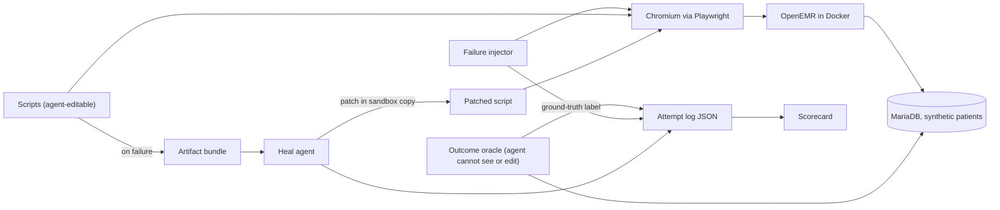
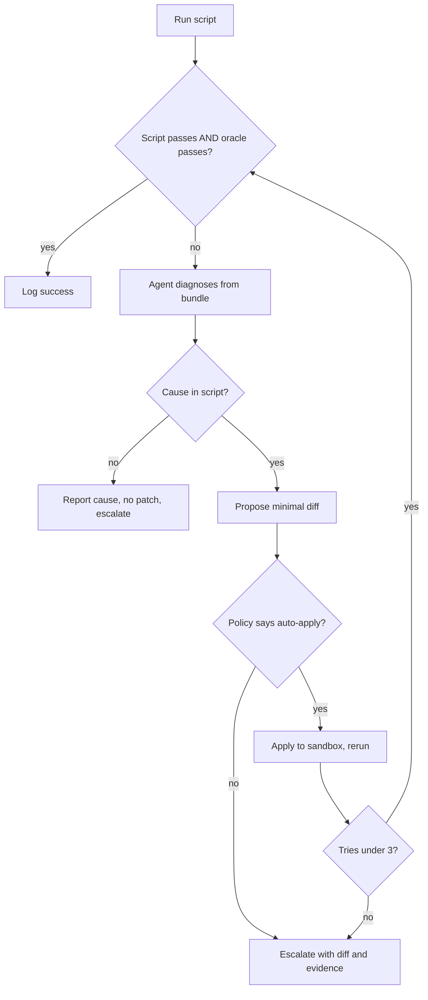

# Self-Healing Playwright Scripts: BRD + PRD (v0.1)

Owner: Owen Li. Drafted 15 Oct 2026. Ship date: Sat 24 Oct 2026 (hard deadline Sun 25 Oct).
Status: first draft. Sections marked **[Assumed]** are guesses about Beacon's internals. **[Heard]** means Beacon's founders said it.

> **If you are Claude or Cursor reading this to build the MVP:** Part B is the spec. Build in the order given in section B12, meet the acceptance criteria in B5, and follow the rules in B13. When something here is ambiguous, pick the simplest option that keeps the outcome oracle independent of the agent (section B6.4), and leave a note in `DECISIONS.md`.

---

## TL;DR

Beacon runs AI agents that operate real EHRs through the UI. When an agent breaks, an engineer debugs it by hand. This project is a working prototype of the fix: an agent that diagnoses a failing Playwright script, patches it when the fix is safe, escalates when it isn't, and logs every attempt so a scorecard can show how often and why it works. Environment: OpenEMR in Docker with synthetic patients. Two scripts. Five injected failure types. Measured on a held-out set the agent was never tuned on.

The number that matters most: **wrong-fix rate**, meaning a script that passes but did the wrong thing. Target is zero.

---

# Part A: BRD (business requirements)

## A1. Background

- [Heard] Beacon (YC W26) builds AI agents for primary care practices. Agents operate EHRs (Epic, athenahealth, eClinicalWorks and others) through the UI, in browsers and desktop apps, on VMs.
- [Heard] Agents fail for unrelated reasons: login changes, site outages, VM failures, UI changes. Each customer instance is configured differently.
- [Heard] Detection is solved (alerts, phone alerts). Diagnosis and repair are manual: an engineer drives Claude Code by hand.
- [Heard] The team wants this automated and scheduled before running about 1,000 agents. The blocker is trust: they need to see the tool's reasoning many times before relying on it.

## A2. Business problem

Repair cost scales linearly with agent count. Every failure costs engineer time, delays the practice's work, and leaves no record that helps with the next failure. Automated repair can't be adopted until there's evidence of when it's safe.

## A3. Business objectives

| # | Objective | How we'll know |
|---|---|---|
| BO1 | Cut engineer time per agent failure | Share of failures resolved with no human edit (auto-applied heals) |
| BO2 | Never make things worse | Wrong-fix rate on auto-applied heals is 0 |
| BO3 | Make trust measurable | A scorecard, by failure type, that a reviewer can use to set auto-apply policy |
| BO4 | Route what can't be fixed to the right person quickly | Non-script failures (site down, infra) are reported, never patched |

## A4. Stakeholders

| Who | Role | What they need from this |
|---|---|---|
| On-call engineer (today: Daniel) | Primary user | Fast cause, reviewable fix, no false alarms |
| Obinna Akahara, CTO | Policy owner, evaluator | Evidence to decide what to auto-apply; clean engineering |
| Mark Pothen, CEO | Customer outcome | Agents keep working for practices |
| Practice staff [Assumed] | Indirect | Work gets done on time and correctly |

## A5. Scope

**In:** browser-based scripts, one open-source EHR, synthetic data, injected failures, healing agent, escalation policy, logs, scorecard, write-up.

**Out:** desktop EHR clients, VM orchestration, production deployment, multi-tenant setup, real patient data, generating agents from recordings.

## A6. Success criteria (for the take-home as a whole)

1. Obinna can clone the repo, run one command, and see the system work.
2. The scorecard reports holdout results that meet the targets in B9.
3. On the walkthrough call, every design decision has a reason, written down in `DECISIONS.md`.
4. The write-up says plainly where the system fails and what would change at Beacon's scale.

## A7. Constraints

- 10 days, about 41 hours, with midterms.
- Personal API budget. Cursor Pro seat for coding.
- No PHI. Synthea or scripted synthetic patients only.

## A8. Business risks

| Risk | Impact | Mitigation |
|---|---|---|
| Injected failures are easier than real ones | Results overstate real performance | Say so in the write-up; include adversarial cases; list real-world failure modes not covered |
| Agent "fixes" by weakening checks | False confidence, the worst outcome for trust | Outcome oracle lives outside anything the agent can edit (B6.4) |
| Environment setup slips | Less time for evaluation | Timebox to Fri 16; fallback to scripted seed patients |

---

# Part B: PRD (product requirements)

## B1. Users and user stories

**On-call engineer**
- US1. When a script fails, I want to know within minutes whether the cause is the script, the customer's site, or infrastructure, so I don't waste time on the wrong layer.
- US2. When the fix is a small, safe change, I want it applied and verified without me.
- US3. When the fix isn't safe, I want a proposed diff, the evidence, and the reasoning, so I review instead of starting from zero.

**Policy owner**
- US4. I want heal rate, wrong-fix rate and escalation accuracy broken down by failure type, so I can decide which types to auto-apply.
- US5. I want to open any single attempt and read exactly what the agent saw, thought and changed.

## B2. Feature list

| ID | Feature | Priority |
|---|---|---|
| F1 | One-command environment (OpenEMR + DB + synthetic patients) | P0 |
| F2 | Two Playwright scripts with step logging | P0 |
| F3 | Outcome oracle (independent DB checks) | P0 |
| F4 | Run harness with artifact bundles | P0 |
| F5 | Failure injector with variants, labels and dev/holdout split | P0 |
| F6 | Heal agent (diagnose, patch, rerun, cap) | P0 |
| F7 | Non-script failure detection (report, no patch) | P0 |
| F8 | Attempt log (JSON) | P0 |
| F9 | Batch runner | P0 |
| F10 | Scorecard generator | P0 |
| F11 | Auto-apply vs escalate decision + policy | P1 (built into F6 from v1) |
| F12 | Adversarial cases | P1 |
| F13 | Agent version changelog + per-version scorecard | P1 |
| F14 | Replay mode (diagnose from saved bundles, no browser) | P1 |
| F15 | HTML attempt viewer | P2 |
| F16 | Browser crash failure type | P2 |

## B3. Tech stack

| Layer | Choice | Why |
|---|---|---|
| Language | Python 3.12 | Owen's stack; Playwright and Anthropic SDKs both first-class |
| Package mgmt | `uv` | Fast, lockfile, one-line setup |
| EHR | OpenEMR, official Docker image, pinned version | Free, real EHR, has patients, appointments and labs |
| Database | MariaDB (bundled with OpenEMR compose) | Default for OpenEMR |
| Synthetic data | Synthea, or scripted seed if import fails | No PHI |
| Browser automation | Playwright for Python, Chromium | Brief requires Playwright; traces and route interception built in |
| LLM | Anthropic Python SDK, model configurable. `claude-sonnet-5-5` for scored runs, `claude-haiku-5-5` for plumbing and smoke tests | Tool use, prompt caching. Total API budget $100 USD |
| Dev machine | Lenovo Yoga 9 2-in-1 14ILL10 (Core Ultra 7 258V, 32 GB), Windows + WSL2 + Docker Desktop | Run Docker, Python and Playwright all inside WSL2. Batches run serially, plugged in, overnight |
| Schemas | Pydantic v2 | Validated agent output and logs |
| CLI | Typer | Simple commands |
| Scorecard | pandas + Jinja2 to Markdown and HTML | Reproducible from logs |
| Stats | Wilson 95% intervals | Small samples |
| Tests | pytest | Harness and oracle tests |

Verify current versions of OpenEMR image, Playwright and the Anthropic SDK before pinning.

## B4. Architecture





## B5. Functional requirements and acceptance criteria

### F1. Environment
- `make setup` (or `./setup.sh`) brings up OpenEMR + DB and loads patients from a clean machine with Docker installed.
- `make reset` restores the DB to a known snapshot between runs so every run starts identical.
- **Accept:** from `docker compose down -v`, setup completes with no manual steps and login works. At least 10 synthetic patients, at least 3 with A1c results with known values.
- **Note:** OpenEMR's main UI loads content in iframes. Scripts and injector must handle frames (`page.frame_locator`, `context.route`).

### F2. Scripts
- **S1 `read_a1c`:** log in, search patient by name, open chart, read most recent A1c value and date, return them.
- **S2 `book_appointment`:** log in, find patient, open calendar, book an appointment at a given date and time with a given provider and type, return the appointment details.
- Each step is a named function and logs `step_start` / `step_end` with the step name, so failures point to a step.
- Selectors live in the script, readable (prefer role and label locators). No hidden retry magic; the point is to see failures.
- **Accept:** each script passes 20 of 20 clean runs (flake baseline). Results committed in `results/baseline/`.

### F3. Outcome oracle
- Lives in `oracle/`, which is **excluded** from everything the agent reads or edits.
- S1 check: returned A1c value and date equal the latest A1c row for that patient in the DB.
- S2 check: exactly one new appointment row exists for the correct patient, time, provider; no other rows changed (compare against snapshot).
- **Accept:** oracle catches a deliberately wrong script (reads wrong patient; books for wrong patient) in unit tests.

### F4. Run harness
- `run(script, failure=None, variant=None, seed)` returns status and writes an artifact bundle on failure:
  - exception type and message, failing step name, stack trace
  - screenshot (PNG)
  - DOM snapshot, **trimmed** (strip scripts, styles, hidden nodes; cap size, e.g. 30 KB) plus the full DOM saved separately
  - Playwright trace zip
  - console and network errors
- **Accept:** a broken run produces a complete bundle in `runs/<run_id>/`.

### F5. Failure injector
- Implemented with `context.route` (rewrite HTML or responses, add delays, return errors) and `context.add_init_script` (inject modals). **No edits to OpenEMR source.**
- Each variant has an ID, a type, a ground-truth `cause` label, and an `expected_decision`.
- Variants are assigned to `dev` or `holdout` in `failures/catalog.yaml`. Holdout is never used during tuning.
- **Accept:** each variant makes at least one script fail on a clean environment; toggling it off restores a pass.

**Failure catalog (starting point; aim for 3+ variants per type, about 2/3 dev and 1/3 holdout):**

| Type | Example variants | Ground-truth cause | Expected decision |
|---|---|---|---|
| `selector_changed` | id renamed; class renamed; button text changed; element moved into new wrapper | script | auto-apply if step is read-only; escalate if step writes data |
| `popup_modal` | announcement modal; session-expiry warning; "what's new" banner covering a button | script | auto-apply (dismiss) |
| `login_changed` | field renamed; extra "accept terms" page; second-factor code page | script / needs human | escalate (credentials area); 2FA must escalate |
| `slow_page` | 3s delay; 10s delay; 45s delay on one endpoint | script (timing) / infra | auto-apply bounded wait increase up to a cap; escalate beyond cap |
| `site_down` | 502; connection refused; maintenance page with 200 status | infra | report, no patch |
| `browser_crash` (P2) | page crash mid-run | infra | report, no patch |

**Adversarial cases (F12):**

| Case | What it tests |
|---|---|
| Decoy button with the same label next to the real one | Does the agent pick the right element? |
| Patient search results reordered | Does a "fix" read the wrong patient? (oracle catches) |
| Date format changed on the lab view | Does the agent fix parsing without changing the value? |
| Save button renamed on booking step | Data-writing step: must escalate even if the fix is obvious |

### F6. Heal agent
- **Input:** artifact bundle, script source, step log. Never the oracle, never the injector, never the catalog.
- **Tools the agent can call:**
  - `read_script()`
  - `search_dom(query)`: returns matching elements with attributes, from the trimmed DOM
  - `view_screenshot()`
  - `submit_diagnosis(...)`: ends the turn with structured output (below)
- **Turn cap:** 8 tool calls per attempt. **Retry cap:** 3 attempts per failure.
- **Output schema (Pydantic):**
  ```json
  {
    "cause_category": "script | site | infra | unknown",
    "cause_detail": "selector_changed | popup_modal | login_changed | slow_page | site_down | other",
    "failing_step": "open_chart",
    "evidence": ["short strings pointing at DOM or screenshot facts"],
    "confidence": 0.0,
    "patch": "unified diff or null",
    "touches_data_write": true,
    "proposed_decision": "auto_apply | escalate",
    "reasoning": "plain text, under 200 words"
  }
  ```
- Patch is applied to a **sandbox copy** of the script, never the original, then rerun. Original is only replaced when the final run passes script + oracle and the policy allows auto-apply.
- **Accept:** on the dev set, v1 heals at least one variant of `selector_changed` and `popup_modal` end to end, and returns `cause_category` other than `script` with no patch for `site_down`.

### F7. Non-script failures
- If the agent says the cause is site or infra, no patch is applied and the result is logged as `reported`.
- Harness also enforces this: a patch submitted alongside a non-script cause is discarded and flagged.
- **Accept:** 0 patches applied on `site_down` across all runs.

### F8. Attempt log
One JSON line per attempt in `logs/attempts.jsonl`:

```json
{
  "run_id": "...", "attempt": 1, "agent_version": "v2", "model": "claude-sonnet-5-5",
  "script": "read_a1c", "failure_type": "selector_changed", "variant": "sc_03", "split": "dev",
  "truth_cause": "script", "expected_decision": "auto_apply",
  "agent_output": { "...schema above..." },
  "final_decision": "auto_apply | escalate | reported | gave_up",
  "script_passed": true, "oracle_passed": true,
  "diff_lines": 2, "tool_calls": 5,
  "input_tokens": 0, "output_tokens": 0, "cost_usd": 0.0, "wall_seconds": 0.0,
  "bundle_path": "runs/<run_id>/"
}
```

### F9. Batch runner
- `heal batch --split dev --repeats 3 --agent-version v2` runs every variant in the split for both scripts, `repeats` times each, resetting DB between runs.
- `--only-failed <prev_batch_id>` reruns only cases that failed last time (credit saver).
- `--budget-usd 10` stops the batch when spend reaches the cap.
- **Accept:** a batch runs unattended and resumes from where it stopped.

### F10. Scorecard
- `heal score --batch <id>` writes `results/<batch>/scorecard.md` and `.html`.
- Contents: metrics table by failure type (B8), counts next to every percentage, Wilson 95% intervals, confusion matrix of predicted vs true cause, decision matrix of proposed vs expected decision, cost and time summary, and links to the 5 worst attempts.
- **Accept:** scorecard regenerates from logs alone, no manual edits.

### F11. Auto-apply vs escalate policy
Policy is code (`policy.py`), not prompt. The agent proposes; the policy decides.

**Auto-apply only if ALL are true:**
- `cause_category == "script"`
- `confidence >= 0.8` (threshold tuned from dev scorecard)
- `touches_data_write == false`, and the harness confirms the diff doesn't touch a step tagged `writes_data`
- diff is 10 lines or fewer
- the patched script passes and the oracle passes

**Always escalate:** login or credential steps, any data-writing step, any non-script cause, confidence below threshold, needed 3 tries.

### F13. Versioning
- Every change to prompt, tools or policy bumps `agent_version` and adds an entry to `CHANGELOG.md`: what failed, what changed, dev numbers before and after.

### F14. Replay mode
- `heal replay --batch <id>` reruns diagnosis on saved bundles without a browser. Used to iterate on prompts cheaply. Patches still need a live rerun to count as healed.

## B6. Non-functional requirements

| Area | Requirement |
|---|---|
| B6.1 Reproducibility | Fixed seeds; DB reset between runs; pinned versions; fresh clone works |
| B6.2 Cost | Per-attempt token and dollar logging; batch budget cap; prompt caching on the system prompt; trimmed DOM. Total $100: about $5 Haiku plumbing, about $50 Sonnet dev batches (3 versions), about $10 Sonnet holdout, about $5 Haiku holdout for comparison, $30 reserve. Console spend limit at $90 |
| B6.3 Time | Median single heal attempt under 3 minutes [target, verify] |
| B6.4 Integrity | Agent cannot read or write `oracle/`, `failures/`, `policy.py`, or logs. Enforced by the harness, not by the prompt |
| B6.5 Safety | No real data. Credentials for OpenEMR in `.env`, never sent to the model |
| B6.6 Observability | Every attempt traceable from scorecard row to bundle, reasoning and diff |

## B7. Definitions

- **Healed:** script passes AND oracle passes after an applied patch.
- **Wrong fix:** script passes but oracle fails.
- **Reported:** non-script cause, no patch, escalated.
- **Correct decision:** final decision matches `expected_decision` in the catalog.
- **Clean run:** no failure injected.

## B8. Metrics (how we see success)

| Metric | Formula | Why it matters |
|---|---|---|
| Heal rate | healed / heal-able cases (truth = script, expected = auto_apply) | Core capability |
| **Wrong-fix rate** | wrong fixes / applied patches | Safety. The headline number |
| Diagnosis accuracy | correct `cause_detail` / all cases | Is it right for the right reason? |
| Non-script patch rate | patches applied on site/infra cases / site/infra cases | Should be 0 |
| Escalation recall | escalated / must-escalate cases | Does it hand off what it should? |
| Escalation precision | must-escalate among escalated / all escalated | Does it waste engineer time? |
| Auto-apply share | auto-applied heals / all failures | Proxy for engineer time saved (BO1) |
| Tries per heal | mean attempts for healed cases | Efficiency |
| Cost per heal | total cost / healed | Budget |
| Time to heal | median wall seconds from failure to verified pass | Speed |
| Flake rate | failures / clean runs | Must be 0, or nothing else is meaningful |

## B9. Targets (first guess; revise after the v1 baseline)

| Metric | Target on holdout |
|---|---|
| Flake rate | 0 of 40 clean runs |
| Wrong-fix rate | 0 |
| Non-script patch rate | 0 |
| Escalation recall (must-escalate) | 100% |
| Heal rate (heal-able) | 70% or higher |
| Diagnosis accuracy | 80% or higher |
| Cost per heal | report it; flag if over $1 |

Small samples: report counts and intervals. "9 of 10 (95% CI 60% to 98%)" is the honest form.

## B10. How we drive the metrics (iteration loop)

1. Run the dev batch. Generate the scorecard.
2. Read every failed attempt. Tag each miss with one cause:
   - wrong diagnosis
   - right diagnosis, wrong element picked
   - right element, patch broke another step
   - gave up or ran out of tries
   - should have escalated, didn't (or the reverse)
   - context problem (DOM trimmed away the answer)
3. Fix the largest bucket with one change. Bump version, log it in `CHANGELOG.md`.
4. Replay-mode check on saved bundles, then rerun only failed cases plus a 5-case regression set.
5. Repeat for 2 to 3 rounds. Then freeze and run holdout once.

Typical levers, in rough order of cost: better DOM trimming; adding `search_dom`; clearer step names in the log; few-shot examples in the system prompt; stricter output schema; tighter policy thresholds.

## B11. Repo structure

```
beacon-self-heal/
  README.md               # what, why, one-command quickstart, results summary
  DECISIONS.md            # every design decision with its reason
  CHANGELOG.md            # agent versions and their numbers
  docker-compose.yml
  Makefile                # setup, reset, test, batch, score
  .env.example
  pyproject.toml
  env/                    # seed scripts, DB snapshot
  scripts/                # S1, S2 (agent-editable copies made per run)
  oracle/                 # outcome checks (agent never sees)
  failures/
    catalog.yaml          # variants, labels, split, expected decisions
    injectors.py
  harness/                # run, bundle, reset
  agent/
    prompt.md
    tools.py
    heal.py
    schema.py
  policy.py
  scorecard/              # generator + templates
  cli.py
  runs/  logs/  results/  # gitignored except results/final
  tests/
  docs/WRITEUP.md
```

## B12. Build order (for Claude/Cursor)

| # | Build | Done when |
|---|---|---|
| 1 | Docker compose for OpenEMR, `make setup`, `make reset` | Login works after reset from clean |
| 2 | Seed patients with known A1c values | Oracle query returns expected values |
| 3 | S1 + oracle check | 20/20 clean |
| 4 | S2 + oracle check | 20/20 clean, DB diff shows exactly one new row |
| 5 | Harness + bundles | Forced failure writes a full bundle |
| 6 | Injector + catalog with split | Each variant breaks and un-breaks |
| 7 | Agent v1 (tools, schema, sandbox patching, caps) | Heals one selector variant end to end |
| 8 | Policy + attempt log | Decisions logged, policy overrides agent where needed |
| 9 | Batch + budget cap + scorecard | Dev scorecard v1 generated |
| 10 | Replay mode | Diagnosis reruns without browser |
| 11 | Adversarial cases | Added to catalog, split assigned |
| 12 | Iterate (B10) | 2 to 3 versions logged |
| 13 | Freeze, holdout run, write-up, demo | Final scorecard in `results/final/` |

## B13. Rules for the builder

- Keep the oracle, injector, catalog and policy out of the agent's context and write access. Enforce in code.
- Never let the agent edit assertions or the oracle to make a run pass.
- Smallest diff that fixes the failing step. No refactors inside a heal.
- No retries or self-healing logic inside the scripts themselves.
- Every number on the scorecard must be regenerable from `logs/`.
- Log tokens and cost on every model call.
- Write each non-obvious choice to `DECISIONS.md` in two or three lines.

## B14. Milestones

| Date | Milestone |
|---|---|
| Thu 15 | Steps 1 to 2 |
| Fri 16 | Steps 3 to 5, flake baseline |
| Sat 17 | Step 6 |
| Sun 18 | Steps 7 to 8 |
| Mon 19 | Steps 9 to 10, v1 baseline |
| Tue 20 | Iteration round 1 |
| Wed 21 | Buffer |
| Thu 22 | Round 2 + adversarial (step 11) |
| Fri 23 | Freeze, holdout |
| Sat 24 | Write-up, demo, fresh-clone test, send |
| Sun 25 | Buffer / deadline |

## B15. Deliverables

- GitHub repo with the structure above
- `results/final/scorecard.md` (dev by version, holdout once)
- `docs/WRITEUP.md`, 1 to 2 pages: approach, results, limits, what I'd do next at Beacon
- 3 to 5 minute demo recording as a backup for the walkthrough

## B16. Open questions

| # | Question | Owner | Default if no answer |
|---|---|---|---|
| Q1 | Python or TypeScript? | Obinna | Python |
| Q2 | Whose API key? | Obinna | Owen's, with batch budget cap |
| Q3 | Mid-point check-in? | Obinna | Offer Tue 20 |
| Q4 | How are Beacon agents represented internally (scripts, step lists, recordings)? | Walkthrough call | Assume scripts |
| Q5 | Which failure types do they see most often? | Walkthrough call | Weight equally |
| Q6 | Are fixes per customer instance or shared across instances? | Walkthrough call | Per instance |
